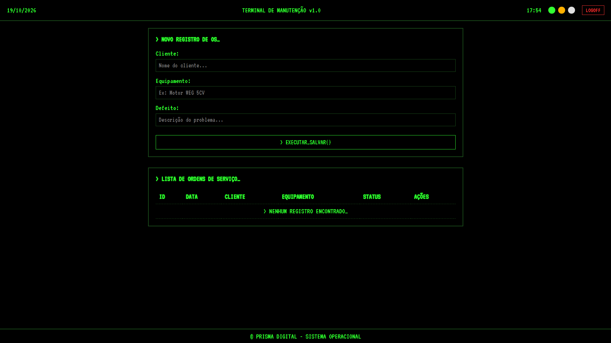
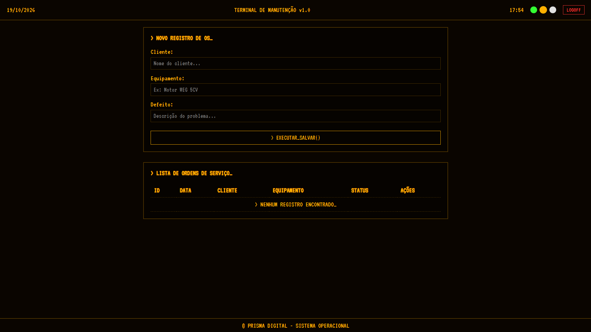
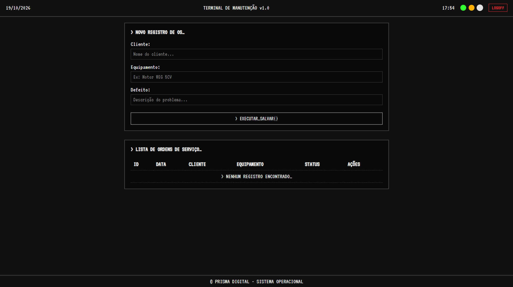

# Terminal de Manutenção (TRS-80 Style) - Full Stack

Um sistema de gestão de Ordens de Serviço (OS) com interface nostálgica inspirada nos terminais de fósforo verde e âmbar da década de 80 (TRS-80).

## 🚀 Tecnologias

- **Frontend:** Angular 21 (Signals, Standalone Components, OnPush)
- **Backend:** C# (.NET 8) com Entity Framework Core
- **Banco de Dados:** SQLite

## ✨ Funcionalidades

- CRUD completo de Clientes e Ordens de Serviço.
- Autenticação com login real validado no banco de dados.
- 3 temas dinâmicos: Verde, Âmbar e Monocromático.
- Efeito de digitação (Typewriter) e bipes de sistema.
- Modal de confirmação de exclusão (segurança).
- Máscaras de formatação (CPF/CNPJ, Telefone, CEP).

## 📸 Screenshots

|               Tema Verde               |               Tema Âmbar               |          Tema Monocromático          |
| :------------------------------------: | :------------------------------------: | :----------------------------------: |
|  |  |  |

## 🛠️ Como rodar o projeto

### 1. Backend (C#)

1. Clone o repositório: `git clone https://github.com/LiltonMagalhaes/terminal-manutencao-backend.git`
2. Entre na pasta: `cd TerminalBackend`
3. Rode as migrações: `dotnet ef database update`
4. Inicie o servidor: `dotnet run` (ele vai rodar em `http://localhost:5125`)

### 2. Frontend (Angular)

1. Clone este repositório.
2. Instale as dependências: `npm install`
3. Rode o projeto: `ng serve`
4. Acesse `http://localhost:4200`

_(Login de teste: admin@prisma.com / 123456)_
